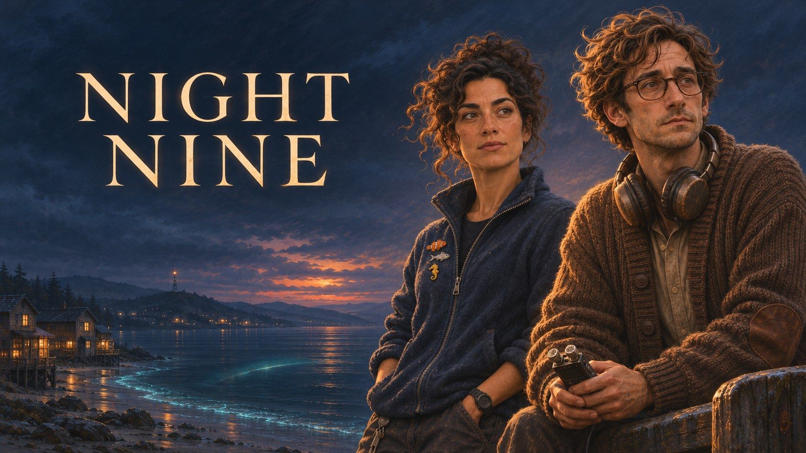

# Night Nine



A painted point-and-click mystery set in Bellwether. Steve Mercer hears the same greeting twice, with the same breath and hesitation. He sets out to learn how two mornings could sound exactly alike.

## Play

For the free desktop edition, extract the Windows x64 or macOS download and open **Night Nine**. To play from source, open `game/project.godot` in Godot 4.7.2, wait for import, then press F5. From a terminal, run `godot --path game` after the first import.

Select **New game**. Click an object to investigate, or use **Objects** for a keyboard-accessible list. In rooms with a walkable floor, click a spot or use WASD to move. Open the notebook to review evidence, case theories and the transcript. After initial setup, you can play the full story offline.

You can also play the Web edition from a desktop browser with WebGL 2. Use **Play in browser** on the published Pages site. Your browser keeps its own saves for that site. [Build or host the browser edition](PUBLISHING.md)

## Chapter checkpoints

You can play the original prologue and ten cumulative chapter checkpoints at the `checkpoint/*` tags. Open an earlier one in another directory with `git worktree add --detach ../Night-Nine-chapter-01 checkpoint/chapter-01`. Each checkpoint has a separate default save directory. Play Interlude 1 after Chapter 3 and Interlude 2 after Chapter 6. Play through Chapter 10 for the epilogue and the post-credits scene. You can find subsequent complete editions at the version tags. [Chapter goals](MILESTONES.md)

## Build and test

Install Godot's 4.7.2 desktop export templates from the editor for Mac and Windows builds. Choose the supplied macOS or Windows Desktop preset under **Project → Export**. From a clean checkout on macOS or Linux you can run the portable checkpoint test as follows.

```sh
godot --headless --path game --import
NIGHT_NINE_SAVE_DIR="$(mktemp -d)" godot --headless --path game --audio-driver Dummy --script res://qa/checkpoint.gd
```

The test opens the normal campaign, follows each room through its departure, completes the available story, reloads a completed save and opens the notebook.

## Publication

You can play the official release for free. The Night Nine contributors license their original game code under GNU GPL version 3 only. You may share, modify or sell copies under the applicable terms. [GPLv3](LICENSE) · [Media terms](MEDIA.md) · [Third-party notices](game/LICENSES.txt)

When publishing downloads, provide the matching complete corresponding source alongside the binaries. See [the GitHub publishing guide](PUBLISHING.md) for the local branch, annotated tags and release steps.
