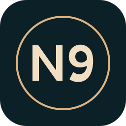

# Night Nine




A painted point-and-click mystery set in Bellwether. Steve Mercer hears the same greeting twice, with the same breath and hesitation. He sets out to learn how two mornings could sound exactly alike.

## Play

**[Play the Cloudflare Pages review build](https://review.night-nine.pages.dev)**. The preview is deployed from `main` to a separate `review` branch. It includes the approved character voices and storybook narration, with the opening music mixed beneath the narration.

Cloudflare Pages is the only game host. GitHub hosts the source and runs the build/deployment workflow; GitHub Pages is retired.

Play in a desktop browser with WebGL 2. There is no installer. The small button in the top-right corner switches to full screen; press Esc to leave it. To edit or test the source, open `game/project.godot` in Godot 4.7.2, wait for import, then press F5.

Select **New game**. **Play Chapters** unlocks each chapter when you reach it, and replays do not replace the **Continue** position or your current autosave. Click a marked object to investigate. Hover over a person in the scene to see who you can talk to, then click their figure for optional small talk. Or press **I** for **Objects**, use **Tab** to reach an object, person, or remote contact, and press **Enter**. In rooms with a walkable floor, click a spot or use WASD to move. Open the notebook to review evidence, case theories and the transcript. After initial setup, you can play the full story offline.

At a case board, read the case notes, pick a card, then pick the question or place where it belongs. You can also drag cards or use Tab and Enter. Press **Check**: right cards turn green and stay, and wrong ones are marked so you can move them. Settings puzzles mark each row the same way. Your placements and confirmed steps are saved as you work. Use **Hint** for another clue.

The recorder, receiver and case boards return throughout the story. Compare voices on tape, follow a trail of documents and tune in a live reply. In the sleeping gallery you can audition family recordings; at KBWR you work the broadcast fader and wait for each return lamp before sending the next cue. Sound captions and visual clues support play without audio. Small talk is optional. We have yet to measure first-time players, so we do not give a playing-time estimate.

Resources are cached for repeat visits and offline play after the first complete load. Updates can require another download. Saves use IndexedDB on the same browser and site address; they do not sync between devices. **Menu → Browser storage** can request persistent storage and export/import checksummed save backups. Browsers can deny persistent storage, and clearing site data still removes saves and cached files. [Build or host the browser edition](PUBLISHING.md)

In the soundtrack edition, you can hear the title music and a background piece and theme for each chapter, interlude, the prologue and the epilogue. You can find the original MP3s in `game/assets/audio/music/` and edit their cues in `game/content/music.json`.

## Chapter checkpoints

To play the prologue or one of ten cumulative chapters with this edition’s puzzles, films and music, choose a `chapters-0.9.2/*` tag. For example, run `git worktree add --detach ../Night-Nine-chapter-04 chapters-0.9.2/chapter-04` and open `game/project.godot` in that directory. You can still find the original development editions at `checkpoint/*`. Each checkpoint has a separate default save directory. Play Interlude 1 after Chapter 3 and Interlude 2 after Chapter 6. Play through Chapter 10 for the epilogue and the post-credits scene. You can find subsequent complete editions at the version tags. [Chapter goals](MILESTONES.md)

## Build and test

The source includes the editable production art and audio masters in `assets/`, their preparation tools in `tools/`, and the runtime copies in `game/assets/`. Keep both forms: the masters are for editing, while the optimized runtime files are used by Godot. Temporary exports, engine caches, credentials and provider response dumps are excluded. [Asset layout](assets/README.md)

For the complete native development suite, set `GODOT_BIN` to Godot 4.7.2 and run `bash tools/test-campaign.sh --render`. Use `NIGHT_NINE_QA_AUDIO_DRIVER=Dummy` when physical sound output is unavailable. The fixed version tags and chapter tags retain their original release contents.

Install Godot's 4.7.2 standard editor and matching single-threaded Web export template. The only production export is **Web**. From a clean checkout on macOS or Linux you can run the portable checkpoint test as follows.

```sh
godot --headless --path game --import
NIGHT_NINE_SAVE_DIR="$(mktemp -d)" godot --headless --path game --audio-driver Dummy --script res://qa/checkpoint.gd
```

The test opens the normal campaign, follows each room through its departure, completes the available story, reloads a completed save and opens the notebook.

In the complete release, run `godot --headless --path game --script res://qa/test_physical_navigation.gd` to check obstacle and door geometry. For a visual check of walking poses and conversations, choose empty directories for `NIGHT_NINE_SAVE_DIR` and `NIGHT_NINE_QA_DIR`, then run `godot --path game --script res://qa/test_social_staging.gd`. You can inspect the captured frames in your QA directory.

In the soundtrack edition, you can use the same isolated save and QA directories with `godot --headless --path game --script res://qa/test_campaign_music.gd` to check the score against the campaign.

## Official credits

| Credit | Contributor |
| --- | --- |
| Original story (written 25 years ago): | S3PehR |
| Built using | Godot Game Engine |
| Original Writing, Creative Decisions and Music Composition: | Sepehr Pakbaz |
| Script Writing, Narration and Game Programming: | Claude Opus 5.5, Gemini 4 Neon, GitHub Copilot Fusion |
| Artworks, Characters: | GPT Image 2.6 |
| Music Generation: | Google Lyria 3.5 |
| Voices: | ElevenLabs 4 |
| Code Deployment, Testing and hosting: | GitHub |
| Game hosting | Cloudflare Pages |

The credit sequence has four pages: story/engine/composition (S3PehR, Godot Game Engine, Sepehr Pakbaz), script/narration/programming (Claude Opus 5.5, Gemini 4 Neon, GitHub Copilot Fusion), media generation (GPT Image 2.6, Google Lyria 3.5, ElevenLabs 4), and hosting (GitHub, Cloudflare Pages).

## Publication

You can play the official release for free. The Night Nine contributors license their original game code under GNU GPL version 3 only. You may share, modify or sell copies under the applicable terms. [GPLv3](LICENSE) · [Media terms](MEDIA.md) · [Third-party notices](game/LICENSES.txt)

When publishing downloads, provide the matching complete corresponding source alongside the binaries. See [the Cloudflare publishing guide](PUBLISHING.md) for the build and deployment steps.

The review site is a public preview, not a final release. The approved voice set and storybook narration are enabled; historical recordings remain preserved. [Complete story walkthrough (spoilers)](docs/story-walkthrough.md) · [Script and recording handoff](docs/script-v2/README.md)
